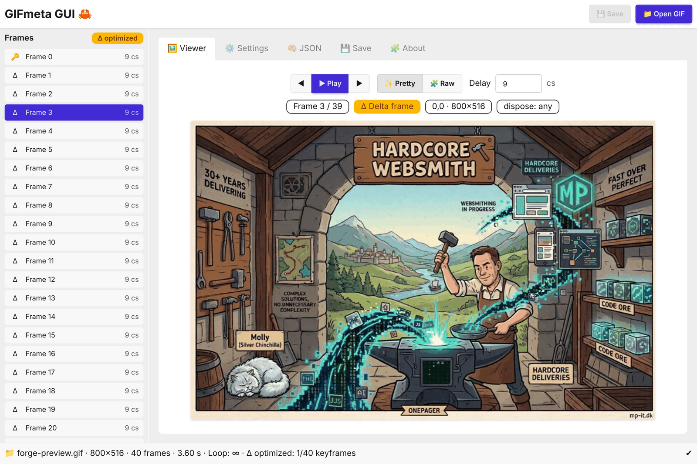
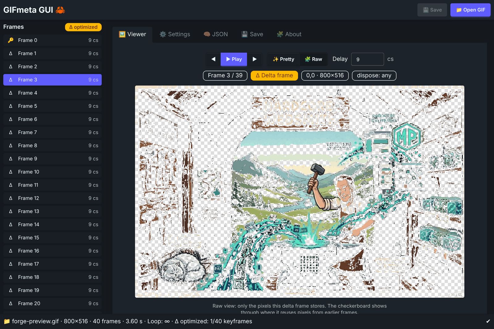
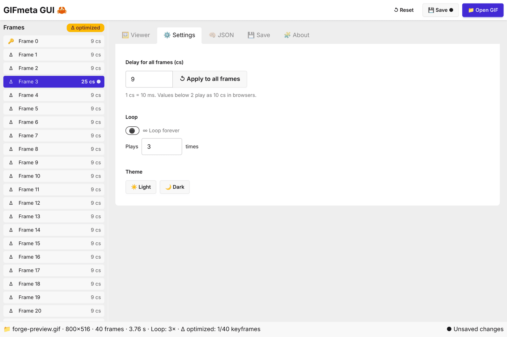
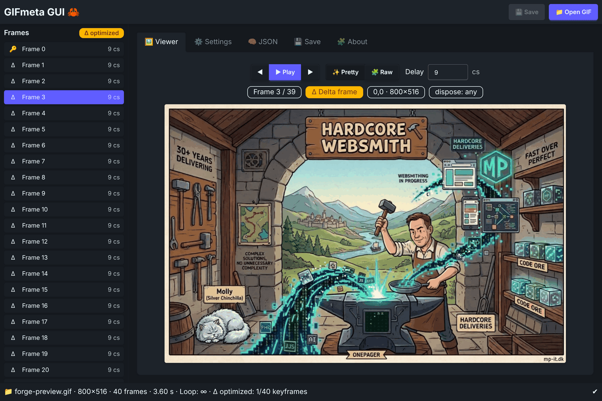
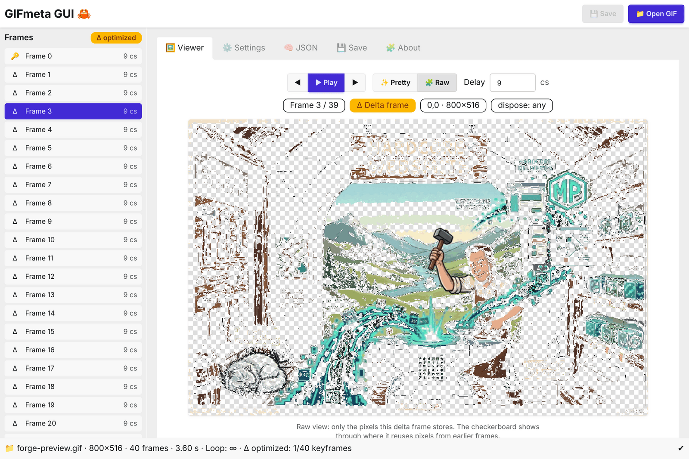
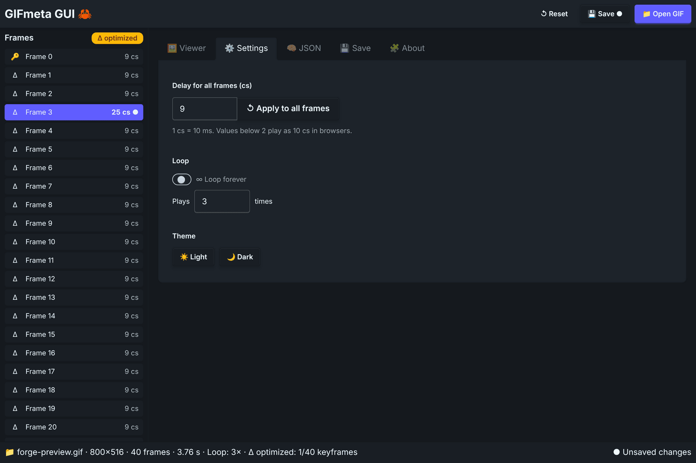

<p align="center">
  
</p>

<h1 align="center">🦀 GIFmeta GUI</h1>

<p align="center">
  <a href="https://github.com/madspaaskesen/gifmeta-gui/releases/latest"></a>
  <a href="https://github.com/madspaaskesen/gifmeta-gui/releases"></a>
  <a href="https://github.com/madspaaskesen/gifmeta-gui/actions/workflows/ci.yml"></a>
  <a href="https://crates.io/crates/gifmeta"></a>
</p>

**A lightweight cross-platform desktop app to inspect and edit GIF metadata.**  
Built with love using [Tauri](https://tauri.app), [Rust](https://www.rust-lang.org/), and [React](https://react.dev/).

> Edit loop counts and frame delays, play your changes before saving, and see how frame-optimized GIFs are built — all in a clean native GUI.  
> Powered by the [gifmeta](https://crates.io/crates/gifmeta) Rust crate.

<p align="center">
  <a href="https://github.com/madspaaskesen/gifmeta-gui/releases/latest"><b>📥 Download for macOS · Windows · Linux</b></a>
</p>

---

## 🚀 Features

- 📁 Open GIF files via native dialog — or drag & drop onto the window
- 🧠 Inspect metadata: dimensions, frames, loop count, transparency, etc.
- 🔑 / Δ Detect **frame-optimized GIFs**: see which frames are keyframes and which are delta frames
- ✨ **Pretty / 🧩 Raw view**: see a frame as it plays, or only the pixels it stores
- ▶ **Play** the GIF with your edited delays before saving
- ⏱️ Edit per-frame delays or set one delay for all frames
- 🔄 Loop forever or a fixed number of plays
- 💾 Save via native dialog, with unsaved-changes indicator and reset
- ⌨️ Keyboard: ↑/↓ change frame, Space play/pause
- 🌒 Light & dark theme
- 💨 Ultra-fast thanks to the Rust backend via Tauri


[](https://sacred-ai.com)
[](https://mysitechart.com/In?github-project=madspaaskesen%2Fgifmeta-gui)

---

## ⚙️ Getting Started

```bash
# Install dependencies
npm install

# Start in development mode
npm run tauri dev
```

Make sure you have Rust installed:
👉 [Install Rust](https://www.rust-lang.org/tools/install)

---

## 🧭 Installation Instructions

Download the installer for your platform from the [latest release](https://github.com/madspaaskesen/gifmeta-gui/releases/latest), then follow the steps here:

👉 [INSTALL.md](INSTALL.md)

---

### 👀 Preview

**Viewer** — frame list with 🔑 keyframes / Δ delta frames, playback and frame info



**Raw view** — only the pixels a delta frame stores (checkerboard = reused from earlier frames)



<details>
<summary>More screenshots (settings, light & dark)</summary>






</details>

---

## 💻 Recommended IDE Setup

* [Visual Studio Code](https://code.visualstudio.com/)

  * [Tauri Plugin for VSCode](https://marketplace.visualstudio.com/items?itemName=tauri-apps.tauri-vscode)
  * [Rust Analyzer](https://marketplace.visualstudio.com/items?itemName=rust-lang.rust-analyzer)

---

## 🌐 Related Projects

* 🔨 [Hardcore Websmith](https://hardcorewebsmith.com) — digital blacksmithing & Rust development, software à la carte
* 🎬 [Flixlar](https://flixlar.com) — fast subtitle editing and export for video, offline speech-to-text, your videos stay on your computer
* 🕊️ [Sacred-AI](https://sacred-ai.com) — gentle AI for emotional reflection
* 📈 [MySiteChart](https://mysitechart.com) — website uptime + visit tracker
* 🛠️ [MP-IT](https://mp-it.dk) — freelance & micro tool development
* 🧵 [DDD Favoritter](https://ddd-favoritter.dk) — personal Danish archive

---

## 🙏 Created by

Forged with clarity and care by
**[🔨 HardcoreWebsmith](https://hardcorewebsmith.com)** — *forging digital solutions since 1993* · *[Mads Paaskesen](https://mp-it.dk)*

---

💛 [@madspaaskesen](https://github.com/madspaaskesen) • [HardcoreWebsmith.com](https://hardcorewebsmith.com) • [Flixlar.com](https://flixlar.com)

---

## 🧠 Philosophy

> GIFmeta is the sacred heart of a minimalist toolkit.
> It brings transparency and control to your looping art,
> so you can create more intentionally — and beautifully.

---

## 📜 License

MIT — feel free to remix, improve, and share with credit.
